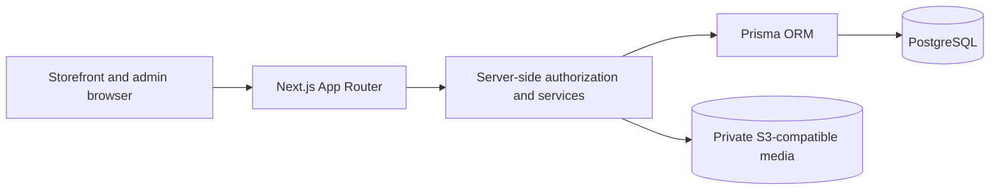

# AAFIYAT SAHEB

**Premium Menswear E-Commerce Platform**

Aafiyat SAHEB is a full-stack commerce project for managing and selling premium Bangladeshi menswear. The current application includes a working administration system and a storefront foundation. The customer-facing shopping journey and production rollout are still in development.

## Project overview

The initial collection spans **T-Shirt, Half Shirt, Full Shirt, Panjabi, and Sherwani**. The project pairs a premium shopping experience with practical tools for managing products and variants, maintaining accurate stock, securing staff access, and publishing content. Customer ordering and payments are part of the planned commerce flow.

## Technology stack

The application versions below match the repository pins and installed packages. PostgreSQL is pinned by the Compose image. The Docker versions describe the verified local tools.

| Technology | Version | Role |
| --- | --- | --- |
| Node.js | 24.x required, 24.14.0 verified | Application and tooling runtime |
| pnpm | 11.1.2 | Dependency management |
| Next.js | 16.4.3 | App Router, route handlers, and Server Actions |
| React / React DOM | 19.3.0 | Storefront and admin interfaces |
| TypeScript | 6.0.3 | Application types and static checks |
| PostgreSQL | 18.6 | Application and authentication data |
| Prisma ORM and Client | 7.10.0 | Database access and migrations |
| Tailwind CSS | 4.3.3 | Utility styles alongside admin CSS Modules |
| Better Auth | 1.7.7 | Password authentication, TOTP, and sessions |
| Sharp | 0.35.5 | Image decoding and normalization |
| S3-compatible object storage | AWS SDK S3 client 3.1158.0 | Private product and CMS media. The bucket and provider are configured separately. |
| Docker and Docker Compose | 29.5.3 and 5.1.4 verified | Local PostgreSQL environment |

## Implemented features

| Area | Current capabilities |
| --- | --- |
| Admin authentication and governance | Password sign-in with TOTP, role-based permissions, session revocation, staff invitations and onboarding, and administrative audit history. Invitation and mailbox-verification delivery have a local test sink. Production email delivery needs a provider adapter and operational configuration. |
| Product management | Category management, product drafts and editing, size and color variants, SKUs, BDT pricing, and publish, discontinue, and archive controls. Publication checks the product's category, eligible variant pricing, and verified image. |
| Inventory | Variant-level balances, stock receiving, physical-count corrections, and append-only movement history. Transactions use locking and retry-safe operation identifiers. Public stock labels are derived separately from internal quantities. |
| Product media | Image validation and normalization, galleries, cover selection, variant associations, and media reconciliation. Uploads require configured private S3-compatible storage. |
| Content | Admin editing and publishing for homepage content, banners, informational pages, and size guides. Media uploads use the same storage configuration. Published-content readers are available for storefront integration. |
| Marketing and settings | Scheduled offers, discount previews, business settings, shipping-policy rules, and consent configuration. Offer redemption in checkout remains pending. |
| Orders and customers | Staff review of existing orders and customer records, order acknowledgements, and permission-controlled access to order history. Customer order placement, payment processing, and full fulfillment remain pending. |

## Project architecture

Next.js serves the public and admin interfaces. Route handlers and Server Actions call server-side services that validate input, enforce authorization, and coordinate database transactions through Prisma. PostgreSQL stores application records and media metadata. A private S3-compatible bucket stores image bytes. Application media routes enforce access and visibility before serving an image.



## Project directory structure

```text
src/
├── app/              Next.js pages, admin UI, and route handlers
└── lib/              Authorization, validation, and business services
prisma/
├── schema.prisma     Data models and client configuration
├── migrations/       Versioned PostgreSQL migrations
└── seed.ts           Initial categories for the local database
scripts/              Operator tools, verification, and reconciliation
docs/                 Requirements, security design, and verification reports
compose.yaml          Loopback-bound local PostgreSQL service
package.json          Runtime requirements, dependency pins, and commands
pnpm-lock.yaml        Locked dependency resolutions
```

## Local development setup

Use **Windows PowerShell**, Git, Node.js **24.x**, pnpm **11.1.2**, and a running Docker engine with Docker Compose.

### 1. Clone and install

```powershell
git clone https://github.com/WadudMahmudJoy/Aafiyat_SAHEB_JOY.git
Set-Location Aafiyat_SAHEB_JOY
node --version
pnpm --version
pnpm install --frozen-lockfile
```

### 2. Configure the local environment

Create `.env` from [the environment template](.env.example) if one does not already exist.

```powershell
if (-not (Test-Path -LiteralPath .env)) {
    Copy-Item -LiteralPath .env.example -Destination .env
}
```

- Replace the local password placeholders. Keep the Compose database name, user, password, and port consistent with `DATABASE_URL`. Percent-encode URL-special characters in the connection string.
- Generate a unique, cryptographically random `BETTER_AUTH_SECRET` of at least 32 characters. Keep it stable across restarts and keep `.env` private.
- Use `BETTER_AUTH_URL=http://localhost:3000` for local HTTP development. Open the app using the same hostname as the configured origin.
- The `MEDIA_S3_*` settings are optional for basic development. Image uploads require a private bucket and valid credentials. Production authentication requires an HTTPS origin.

### 3. Start PostgreSQL and inspect migrations

```powershell
docker compose up -d --wait postgres
pnpm exec prisma generate
pnpm exec prisma migrate status
```

Compose binds PostgreSQL to loopback and persists data in a named volume. An existing volume retains its original database credentials. Check the target of `DATABASE_URL`, including any process-level override, before running migration commands.

**First-time setup on a confirmed empty local database.** A migration status report showing unapplied migrations is expected. Review the committed [migrations](prisma/migrations/), apply them, and seed the initial categories. The seed command is restricted to the default local database, user, and port from the template.

```powershell
pnpm exec prisma migrate deploy
pnpm exec prisma migrate status
pnpm run db:seed
```

**Existing local installation.** Preserve the existing data and volume. Verify the database identity, review pending SQL and migration history, take a backup, and verify that it can be restored before an approved migration deployment. Resolve unexpected migration status or history differences before proceeding.

### 4. Start the application

```powershell
pnpm dev
```

Open [the local application](http://localhost:3000).

## Administrator access

Open [the admin login](http://localhost:3000/admin/login). Public signup is disabled, and the project distributes no default administrator credentials. Initial Owner provisioning is a controlled local operator process. The operator chooses the password, enrolls TOTP, and confirms activation before using a fresh password and TOTP session.

Review the [authentication foundation](docs/authentication-foundation.md) and [Owner bootstrap script](scripts/bootstrap-owner.ts). The read-only preflight for a local database without an Owner is:

```powershell
node --conditions=react-server --import tsx scripts/bootstrap-owner.ts --check
```

Provisioning, enrollment, and activation are separately invoked steps. The bootstrap refuses production and non-local targets. The [disposable Owner rehearsal](docs/owner-onboarding-rehearsal.md) describes a separate verification procedure.

## Product management workflow

1. Open **Products and Inventory** and choose **Add Product** to create a private draft.
2. Add variants with sizes, colors, unique SKUs, and BDT prices.
3. Use **Manage Product Images** to upload verified images, choose a cover, and manage the gallery. Uploads require configured private S3-compatible storage.
4. Open **Manage Inventory** for a variant and record stock through the receiving or correction workflow.
5. Use **Review & Publish** to check the active category, eligible variant pricing, and verified image requirements.
6. Publish when the requirements pass. The server rechecks eligibility within the publication transaction.

## Security highlights

- Admin requests check the current role and active membership. Privileged access requires TOTP proof bound to the current session.
- Governance operations revoke affected sessions and enforce a session cutoff. Staff onboarding binds invitation, mailbox verification, credentials, and TOTP enrollment to the intended identity.
- Authentication and administrative mutations validate the trusted origin. Critical writes use database transactions, and governance and order history preserve append-only records.
- Media inputs are validated and normalized before storage. Private objects are served through application routes with ownership or publication checks.

## Current development status

| Area | Status |
| --- | --- |
| Admin authentication | Implemented and tested with password and TOTP |
| Products and variants | Implemented and tested |
| Inventory and movement ledger | Implemented and tested |
| Admin CMS | Implemented and tested. Storefront rendering is still in development. |
| Staff governance and onboarding | Implemented and tested with isolated email delivery. Production mail, keys, and worker operations are pending. |
| Media storage | Integration tested with isolated S3-compatible storage. Operational configuration and reconciliation schedules are required. |
| Orders and customers | Staff review and acknowledgement are implemented and tested. The complete commerce flow is pending. |
| Public storefront | Landing page and catalog/content data foundations exist. Customer-facing listing, product detail, and shopping interfaces are incomplete. |
| Cart and guest checkout | Pending |
| Payment processing and verification | Pending |
| Production deployment | Pending |

## Development roadmap

- Build the customer-facing homepage with published CMS content, then add product listing and detail pages with galleries and variant selection.
- Implement shopping cart and guest checkout. Apply shipping and offer rules to checkout totals.
- Integrate SSLCOMMERZ and verify payments server-side before accepting paid orders.
- Extend order administration into fulfillment and delivery workflows.
- Configure production private storage and email delivery, schedule reconciliation and invitation workers, and validate deployment, monitoring, backup restoration, and recovery procedures.

## Testing and quality

With dependencies, the generated Prisma Client, and local configuration in place:

```powershell
pnpm exec next typegen
pnpm exec tsc --noEmit
pnpm lint
pnpm exec prisma validate
```

For a local production-build check, temporarily supply an HTTPS authentication origin. This builds the app without changing the development origin in `.env` or starting an HTTPS server.

```powershell
$previousAuthUrl = $env:BETTER_AUTH_URL
try {
    $env:BETTER_AUTH_URL = 'https://localhost:3000'
    pnpm build
} finally {
    $env:BETTER_AUTH_URL = $previousAuthUrl
}
```

The repository includes presentation checks, isolated integration tooling, and browser verification procedures. See the [inventory verification](docs/task-010-a1-inventory-verification.md), [media and publishing verification](docs/task-010-c-media-publishing-verification.md), and [staff activation verification](docs/task-010-e2b2-activation-verification.md) for scope and fixture requirements. Use disposable environments for write-based verification.

## License and project status

Aafiyat SAHEB is under active development. No project-wide license has been specified.
